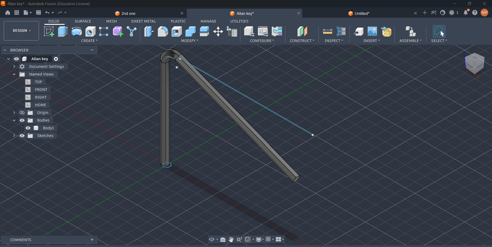
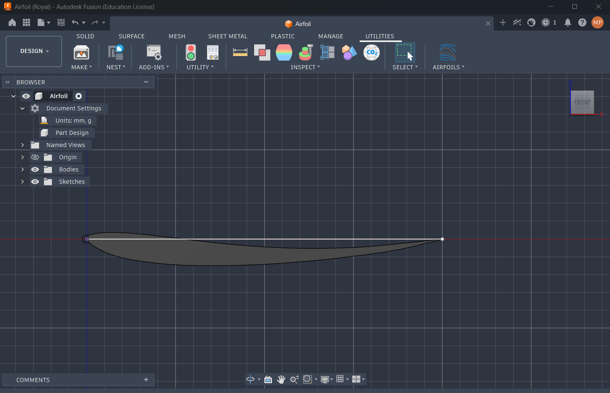
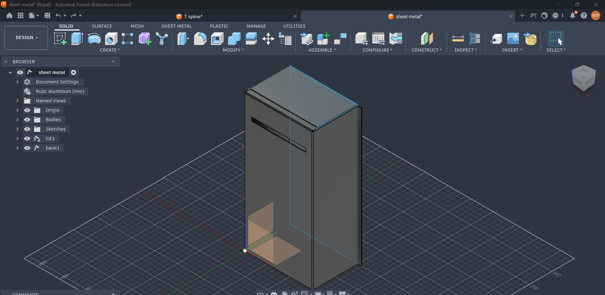
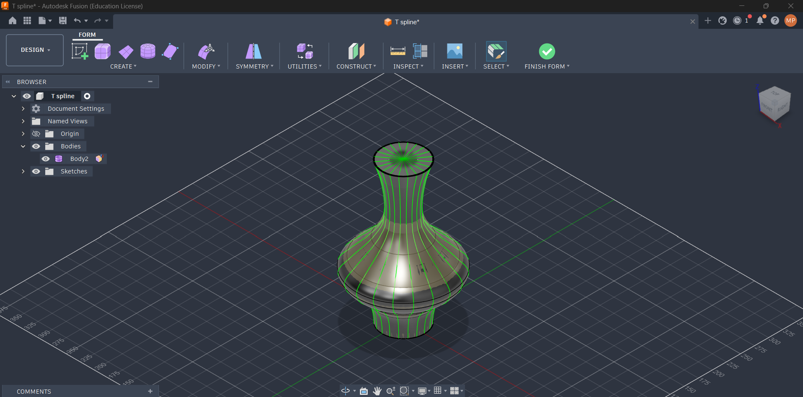
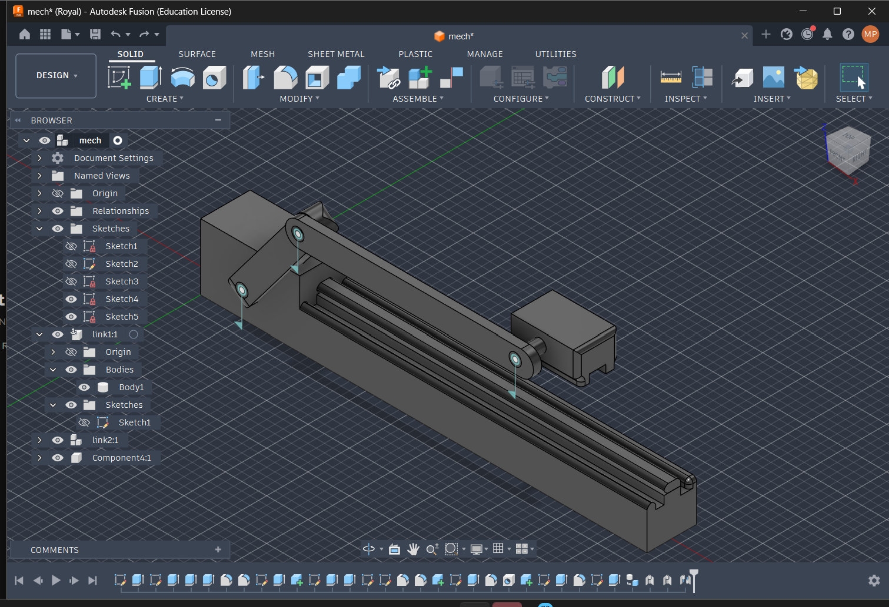
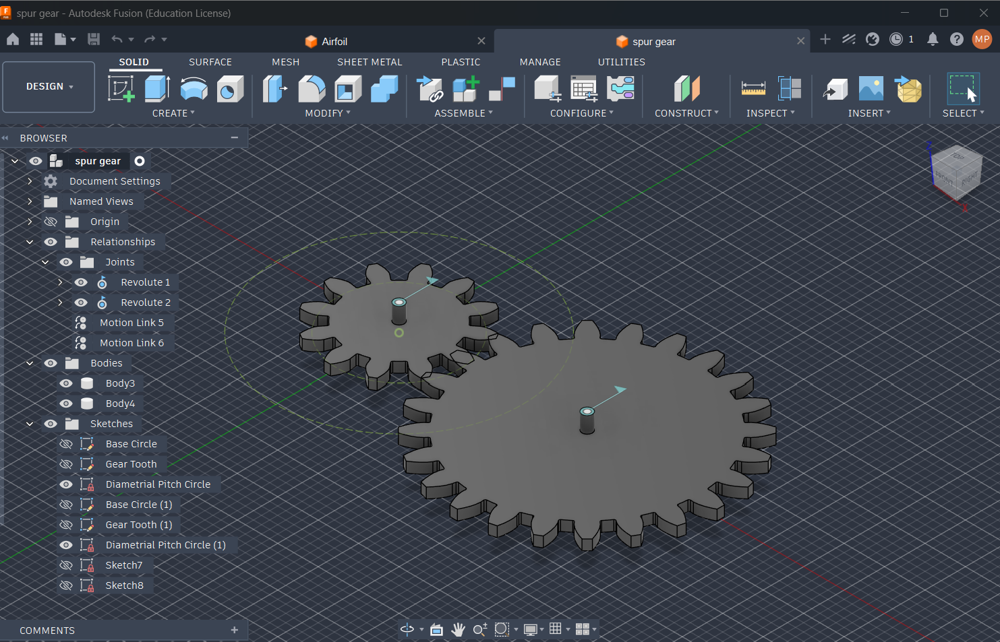

# Task 1:

# Allen Key (Hex Key)

## What it is?
An Allen key, also called a hex key, is an L-shaped hand tool used to turn screws and bolts that have a hexagonal socket in the head. The short leg gives a firm grip in tight spaces, and the long leg gives leverage.

## How it works?
The six flat faces of the key press against the six flat faces of the socket, so the turning force is spread evenly and the key is less likely to slip. The long leg acts as a lever, so a longer leg gives more torque for the same hand force.

## Size:
The size is the distance across opposite flats of the hexagon. Common metric sizes are 2, 2.5, 3, 4, 5, 6, 8 and 10 mm.

## Material:
Usually chrome vanadium or alloy steel, hardened for strength, with a coating such as black oxide or chrome to prevent rust.

## Uses:
Furniture assembly, bicycles, machinery and 3D printers.

## Advantages and limitations:
- Advantages: small, cheap, and works well in tight spaces.
- Limitations: it can round off the socket if the size is wrong or worn, and a standard key cannot be used at an angle.

## Conclusion
The Allen key is a simple tool that transfers torque efficiently through its hexagonal shape and L-bend.

# Task 3:
# Design of a NACA Aerofoil for an HTOL Aircraft Using Fusion 360

## Aim
To design a simple NACA aerofoil for a Horizontal Take-Off and Landing (HTOL) aircraft using Autodesk Fusion 360 and an Airfoil Generator add-in, and to understand aerofoil nomenclature and its basic geometric features.

## Introduction
An aerofoil is a shaped surface designed to generate lift when air flows around it. It is an essential component of an aircraft wing and influences lift, drag and stall characteristics. In this project, a NACA 2412 aerofoil is generated and modelled using Fusion 360.

##  NACA Aerofoil Nomenclature
NACA 2412 is a four-digit aerofoil profile.

- **First digit (2):** Maximum camber is 2% of the chord length.
- **Second digit (4):** Maximum camber occurs at 40% of the chord length from the leading edge.
- **Last two digits (12):** Maximum thickness is 12% of the chord length.

For a chord length of 100 mm, the maximum camber is 2 mm and the maximum thickness is 12 mm.

##  Basic Parts of an Aerofoil
- **Leading Edge:** The front edge of the aerofoil that first encounters the airflow.
- **Trailing Edge:** The rear edge where the upper and lower surfaces meet.
- **Chord Line:** The straight line connecting the leading and trailing edges.
- **Camber Line:** The curve midway between the upper and lower aerofoil surfaces.
- **Maximum Camber:** The greatest distance between the camber line and chord line.
- **Thickness:** The distance between the upper and lower surfaces.

## Result
A NACA 2412 aerofoil profile was generated using the Airfoil Generator add-in in Fusion 360 and converted into a basic 3D wing section.

##  Conclusion
This project provided an understanding of NACA aerofoil nomenclature and the basic geometric features of an aerofoil, including the leading edge, trailing edge, chord line, camber line and thickness. It also introduced the use of Fusion 360 add-ins for generating aerofoil profiles and creating simple 3D wing geometry.

# Task 4:

# Sheet Metal in Fusion 360

## Aim
To understand sheet metal design and its applications using Autodesk Fusion 360.

## Introduction
Sheet metal is thin, flat metal shaped through cutting, bending and folding. Fusion 360 provides tools to design sheet metal components accurately and prepare them for manufacturing.

## Why Do We Use Sheet Metal?
- To create accurate bends and flanges.
- To maintain uniform material thickness.
- To generate flat patterns for manufacturing.
- To reduce material wastage and errors.

## Important Tools
- **Flange:** Creates walls along sheet edges.
- **Bend:** Adds bends to sheet metal.
- **Contour Flange:** Creates shapes along a sketch profile.
- **Flat Pattern:** Unfolds the model into a flat sheet.

## Applications
- Aircraft panels and brackets.
- Automobile body panels.
- Electrical enclosures.
- Machine covers and HVAC ducts.

## Result
Sheet metal tools in Fusion 360 can create components with accurate bends and flat patterns.

## Conclusion
The Sheet Metal workspace simplifies the design of thin metal components and helps prepare them for manufacturing with improved accuracy and reduced material wastage.

# Task 5:

# Design of a Hollow Vase Using Forms in Fusion 360

## Aim
To design a hollow vase using the Forms feature in Autodesk Fusion 360.

## Introduction
The Forms feature in Fusion 360 allows the creation of organic and freeform shapes using T-Spline modelling. It is useful for designing objects with smooth curves, such as vases, bowls and decorative products.

## Applications
- Decorative vases and home accessories.
- Product and industrial design.

## Result
A hollow vase with a smooth, curved surface was designed using the Forms feature in Fusion 360.

## Conclusion
The Forms workspace enables the creation of complex organic shapes through flexible face, edge and vertex editing. It is useful for developing creative product designs and preparing models for 3D printing.

# Task 6:

# Bodies vs Components

## Design Approaches

| Top Down | Bottom Up |
|---|---|
| Fusion 360 | SolidWorks, Autodesk Inventor |
| You create parts within the assembly | You design the parts first, then assemble them |
| If you change one thing, the others change accordingly | If you change one part, other parts might get affected |

## Bodies vs Components

| **Bodies** (Cylinder) | **Components** (Cube) |
|---|---|
| Used with modeling tools | Used for manufactured parts |
| Example: bottle | Example: hinge |
| You can't copy them | You can copy them |
| Don't show in the part list | Show in the part list |
| Independent of the parent | Dependent on the parent |
| You can create a new component from a body | You can't create a new component from a component |

## Types of Bodies

Solid / Sculpt / Mesh

- **Surface** → only the outer side → yellow face
- **Solid** → normal
- **T-spline** → explore shapes, purple
- **Mesh body** → imported, limited mmanner

# Task 7:

# Simple Slider Mechanism

## 1. Introduction
A simple slider mechanism converts motion between two forms. A rotating or swinging input drives a block (the slider) to move back and forth along a fixed straight path. The slider and the guide form a **prismatic (sliding) pair**, which allows motion along one axis only.

## 2. Main Components
| Part | Function |
|---|---|
| Frame / guide | Fixed part that constrains the slider to a straight path |
| Slider | Block that moves back and forth along the guide |
| Crank | Rotating link that provides the input motion |
| Connecting rod | Links the crank to the slider and transmits force |

## 3. Working Principle
1. The crank rotates about a fixed pivot.
2. The connecting rod transfers this motion to the slider.
3. The guide allows only linear movement, so the slider travels back and forth.
4. The slider reaches its extreme positions at the **inner dead centre** and the **outer dead centre**, where its velocity is momentarily zero.
5. The stroke length equals twice the crank radius (2r).

## 4. Degrees of Freedom
- The mechanism has **1 degree of freedom**: one input (crank angle) fixes the position of every part.
- Sliding pairs remove all motion except translation along one axis.

## 5. Types
- **Single slider crank chain**: used in engines and compressors
- **Double slider crank chain**: used in the Scotch yoke and Oldham's coupling
- **Scotch yoke**: gives pure sinusoidal slider motion

## 6. Applications
- Internal combustion engines (piston and cylinder)
- Reciprocating pumps and compressors
- Shaper machines and punching presses
- Drawer slides and sliding doors
- 3D printer and CNC linear axes

## 7. Advantages and Limitations
**Advantages**
- Simple design that is easy to manufacture
- Reliable conversion between rotary and linear motion
- Compact for the force it transmits

**Limitations**
- Friction and wear between the slider and guide
- Needs lubrication
- Speed is not uniform, causing vibration at high speeds
- Side thrust on the guide

## 8. Modelling in CAD
In Fusion 360, make each moving part a **component**, not a body, so that joints can be applied. A **slider joint** between the block and the guide gives the sliding pair, and a **revolute joint** at the crank pivot gives the rotation.

## 9. Conclusion
The simple slider mechanism is a basic building block in machine design. It is used wherever controlled linear motion or rotary-to-linear conversion is needed.

# Task 8:

# Spur Gear:

## 1. Introduction

Spur gears are mechanical components used to transmit rotational motion and power between **parallel shafts**. They have straight teeth and are commonly used in gearboxes, machine tools, and industrial machinery.

## 2. Objective

- To understand the working principle of spur gears.
- To study the important parameters involved in gear design.
- To understand gear strength and durability.

## 3. Working Principle

Spur gears transmit motion through the meshing of their teeth. When the driving gear rotates, it causes the driven gear to rotate in the **opposite direction**. The gear ratio depends on the number of teeth on each gear.

## 4. Important Parameters

| Parameter | Symbol | Description |
|---|---|---|
| Number of teeth | Z | Total number of teeth on the gear |
| Module | m | Ratio of pitch circle diameter to the number of teeth |
| Pitch circle diameter | d | Reference diameter used in gear design |
| Pressure angle | α | Determines the direction of force between meshing teeth |
| Face width | b | Width of the gear teeth along the shaft axis |

The module is calculated as:

$$
m = \frac{d}{Z}
$$

## 5. Design Specifications

| Item | Value |
|---|---|
| Gear ratio | 2 : 1 |
| Input gear (pinion) teeth, Z₁ | 20 |
| Output gear teeth, Z₂ | 40 |
| Module, m | 3 mm |
| Pressure angle, α | 20° |
| Material | Steel |

## 6. Design Calculations

**Gear ratio**

$$
i = \frac{Z_2}{Z_1} = \frac{40}{20} = 2
$$

**Pitch circle diameter** ($d = mZ$)

- Pinion: $d_1 = 3 \times 20 = 60$ mm
- Gear: $d_2 = 3 \times 40 = 120$ mm

**Centre distance**

$$
a = \frac{d_1 + d_2}{2} = \frac{60 + 120}{2} = 90 \text{ mm}
$$

**Other tooth dimensions** (standard full-depth 20° system)

| Quantity | Formula | Pinion | Gear |
|---|---|---|---|
| Addendum | $h_a = m$ | 3 mm | 3 mm |
| Dedendum | $h_f = 1.25m$ | 3.75 mm | 3.75 mm |
| Whole depth | $h = 2.25m$ | 6.75 mm | 6.75 mm |
| Outside diameter | $d_a = m(Z+2)$ | 66 mm | 126 mm |
| Root diameter | $d_f = m(Z-2.5)$ | 52.5 mm | 112.5 mm |
| Base circle diameter | $d_b = d\cos\alpha$ | 56.38 mm | 112.76 mm |
| Circular pitch | $p = \pi m$ | 9.42 mm | 9.42 mm |

**Speed relation**

$$
N_2 = \frac{N_1}{i} = \frac{N_1}{2}
$$

The output gear turns at half the input speed and, ignoring losses, delivers twice the input torque.

## 7. Gear Strength and Durability

A gear must resist two main kinds of failure:

- **Bending failure:** the tooth breaks at the root. Checked with the Lewis equation:

$$
\sigma_b = \frac{F_t}{b \, m \, Y}
$$

  where $F_t = \dfrac{2T}{d}$ is the tangential force and $Y$ is the Lewis form factor.

- **Surface (contact) failure:** pitting and wear on the tooth flanks from repeated contact stress.

Ways to improve strength and durability:

- Choose a strong material such as alloy steel and apply heat treatment or case hardening
- Use an adequate module and face width
- Provide proper lubrication and keep the lubricant clean
- Maintain accurate alignment and correct centre distance

## 8. Conclusion

Spur gears are simple, efficient, and widely used for power transmission between parallel shafts. For the designed pair (Z₁ = 20, Z₂ = 40, m = 3 mm, α = 20°), the gear ratio is 2:1 with a centre distance of 90 mm. Correct selection of module, tooth count, material, and lubrication ensures good strength and a long service life.

